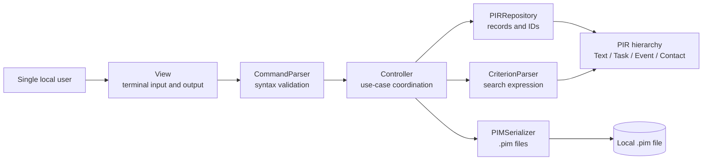
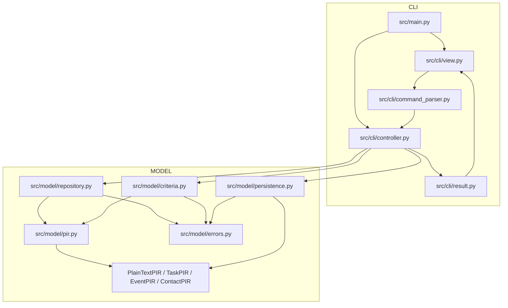
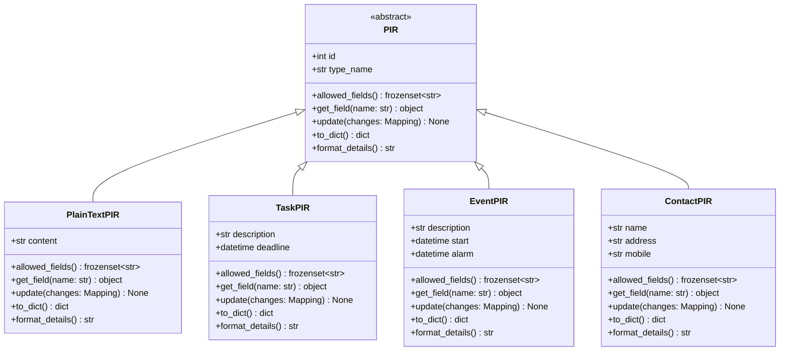
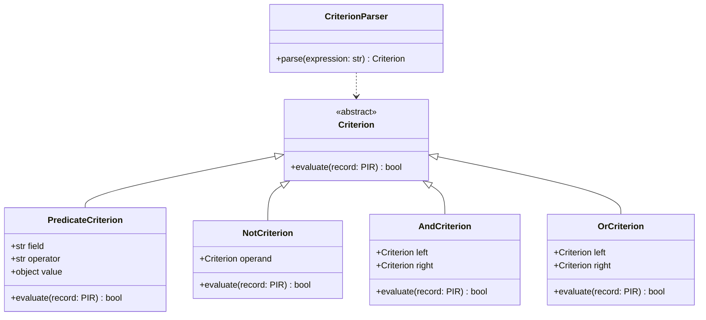
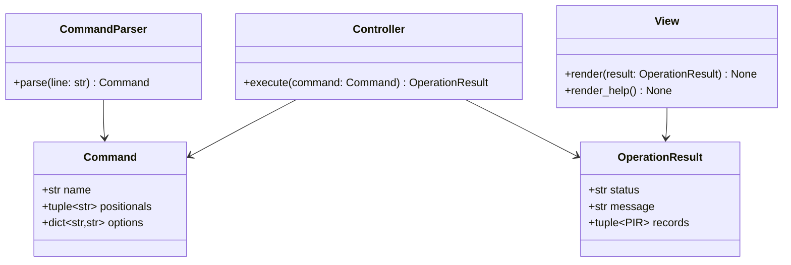
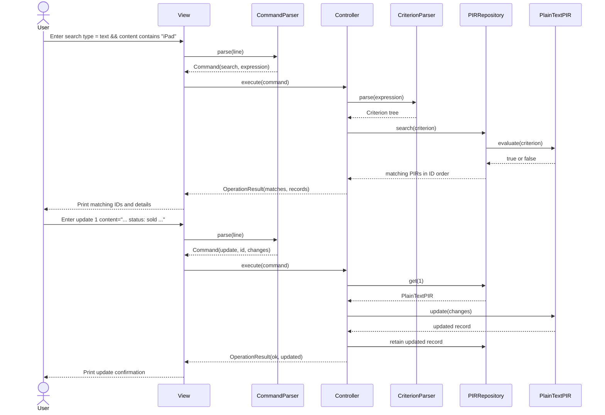

# Design Document

Status: Final submission baseline  
Version: 1.0  
System: Hong Kong Student Second-hand PIM

## 1 Design goals

The design turns the Stage 1 requirements into a small, testable command-line application. It keeps the domain model independent from terminal input and output, gives every PIR type a consistent interface, and makes search and persistence replaceable components.

The design targets Python 3.11 or later and Python standard libraries only. The final developer manual will record the exact Python version and documented development platform.

## 2 Architectural pattern

The system uses Model-View-Controller (MVC).

- **Model** owns PIR data, validation, search evaluation, repository operations, and `.pim` serialization.
- **View** owns prompts and human-readable terminal output.
- **Controller** receives parsed commands, invokes model operations, and converts domain errors into operation results.

MVC is suitable because the model must be unit tested without simulating terminal input. It also keeps command syntax changes in the CLI layer and protects the model from presentation details.



The model never imports the CLI package. The controller is the only component that coordinates the repository, criterion parser, and serializer for a user command.

## 3 Main component relationships



### Component responsibilities

| Component | Responsibility | Depends on |
| --- | --- | --- |
| `main.py` | Create objects and run the command loop | CLI components |
| `CommandParser` | Convert one input line into a typed command | `shlex`, command errors |
| `Controller` | Execute create, update, search, print, delete, save, load, help, and exit | Model components, result type |
| `View` | Display prompts, success output, records, and errors | Result type |
| `PIRRepository` | Allocate IDs, store records, update records, search, and delete | PIR hierarchy, criteria |
| PIR hierarchy | Validate and represent record-specific fields | Python standard library |
| `CriterionParser` | Parse the search grammar into a criterion tree | Criterion classes, PIR field names |
| Criterion classes | Evaluate predicates and logical operators | PIR interface |
| `PIMSerializer` | Validate `.pim` paths and round-trip records | `json`, `pathlib`, PIR factory |
| Domain errors | Give callers stable error categories | `Exception` |

## 4 Domain class design



### Shared PIR contract

| Method | Signature | Return | Exceptions |
| --- | --- | --- | --- |
| `allowed_fields` | `allowed_fields() -> frozenset[str]` | Fields valid for the concrete type | None |
| `get_field` | `get_field(name: str) -> object \| None` | Field value, or `None` when the record has no such field | `ValidationError` for an unknown field name |
| `update` | `update(changes: Mapping[str, object]) -> None` | None | `ValidationError` if a field is unknown, empty, or has the wrong type |
| `to_dict` | `to_dict() -> dict[str, Any]` | Serializable record data | None after a valid object exists |
| `format_details` | `format_details() -> str` | Stable human-readable details | None |

Constructors validate IDs, required strings, and time values. Date and time fields are stored as `datetime` objects in memory and serialized as `YYYY-MM-DDTHH:MM` strings.

### Concrete PIR fields

| Class | Constructor | `type_name` | Allowed fields |
| --- | --- | --- | --- |
| `PlainTextPIR` | `(id: int, content: str)` | `text` | `content` |
| `TaskPIR` | `(id: int, description: str, deadline: datetime)` | `task` | `description`, `deadline` |
| `EventPIR` | `(id: int, description: str, start: datetime, alarm: datetime)` | `event` | `description`, `start`, `alarm` |
| `ContactPIR` | `(id: int, name: str, address: str, mobile: str)` | `contact` | `name`, `address`, `mobile` |

## 5 Repository design

`PIRRepository` stores records in a private dictionary keyed by ID. It returns records in ascending ID order for `all` and `search` so output is deterministic.

| Method | Signature | Return | Exceptions |
| --- | --- | --- | --- |
| `create_plain_text` | `(content: str) -> PlainTextPIR` | New record | `ValidationError` |
| `create_task` | `(description: str, deadline: datetime) -> TaskPIR` | New record | `ValidationError` |
| `create_event` | `(description: str, start: datetime, alarm: datetime) -> EventPIR` | New record | `ValidationError` |
| `create_contact` | `(name: str, address: str, mobile: str) -> ContactPIR` | New record | `ValidationError` |
| `get` | `(record_id: int) -> PIR` | Existing record | `PIRNotFoundError` |
| `update` | `(record_id: int, changes: Mapping[str, object]) -> PIR` | Updated record | `PIRNotFoundError`, `ValidationError` |
| `search` | `(criterion: Criterion) -> list[PIR]` | Matching records | None after criterion validation |
| `all` | `() -> list[PIR]` | All records in ID order | None |
| `delete` | `(record_id: int) -> None` | None | `PIRNotFoundError` |
| `replace` | `(records: Sequence[PIR]) -> None` | None | `ValidationError` for duplicate or invalid IDs |

`update` validates all changes before mutating the record. If one field is invalid, no field from the update is applied.

## 6 Search design

The criterion parser converts the Stage 1 grammar into a tree of `Criterion` objects.



| Class or method | Signature | Return | Exceptions |
| --- | --- | --- | --- |
| `Criterion.evaluate` | `(record: PIR) -> bool` | Whether the record matches | `ValidationError` only for an invalid constructed criterion |
| `PredicateCriterion` | `(field: str, operator: str, value: object)` | Criterion object | `ValidationError` for unsupported field/operator/value |
| `CriterionParser.parse` | `(expression: str) -> Criterion` | Parsed criterion tree | `CriterionParseError` |

The parser enforces precedence `!`, then `&&`, then `||`. Text `contains` comparisons are case-insensitive. A missing field on a concrete PIR evaluates to `False`; an unknown field in the expression is a parse error.

## 7 Persistence design

`PIMSerializer` is the only class that reads or writes `.pim` files.

| Method | Signature | Return | Exceptions |
| --- | --- | --- | --- |
| `save` | `save(records: Sequence[PIR], path: Path) -> None` | None | `PersistenceError`, `ValidationError` |
| `load` | `load(path: Path) -> list[PIR]` | Validated records | `PersistenceError`, `ValidationError` |

The Stage 2 schema is:

```json
{
  "schema_version": 1,
  "records": [
    {"id": 1, "type": "text", "content": "..."},
    {"id": 2, "type": "task", "description": "...", "deadline": "2026-11-20T18:00"}
  ]
}
```

The serializer rejects a non-`.pim` path, a missing required top-level key, an unsupported schema version, duplicate IDs, unknown types, invalid fields, and invalid time strings. It writes through a temporary file and replaces the target only after serialization succeeds.

## 8 CLI design



| Class or method | Signature | Return | Exceptions |
| --- | --- | --- | --- |
| `CommandParser.parse` | `(line: str) -> Command` | Parsed command | `CommandSyntaxError` |
| `Controller.execute` | `(command: Command) -> OperationResult` | Result for the view | Catches domain errors and returns `error` status |
| `View.render` | `(result: OperationResult) -> None` | None | None for valid result objects |
| `main.run` | `() -> None` | None | Handles end-of-input and clean exit |

`Controller.execute` maps `PIMError` subclasses into `OperationResult(status="error", ...)`. The CLI loop therefore continues after recoverable input errors and never exposes a Python traceback during normal use.

## 9 Example use: search then update

The sequence below satisfies the design-document example-use requirement.



## 10 Design-to-requirements mapping

| Requirement area | Design element |
| --- | --- |
| US1-US5 | PIR hierarchy and repository create methods |
| US6 | `PIR.update` and repository atomic update |
| US7 | `CriterionParser` and criterion tree |
| US8-US9 | Repository `all`, `get`, and `delete`; View formatting |
| US10-US11 | `PIMSerializer` and repository `replace` |
| Model unit tests | Model has no CLI dependency |
| Standard library | Python classes, `datetime`, `json`, `pathlib`, `shlex`, and `typing` |

